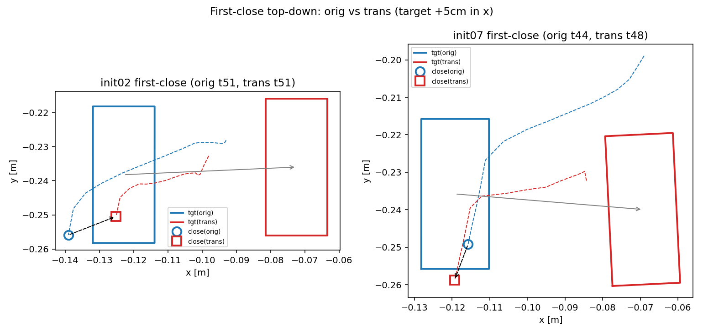
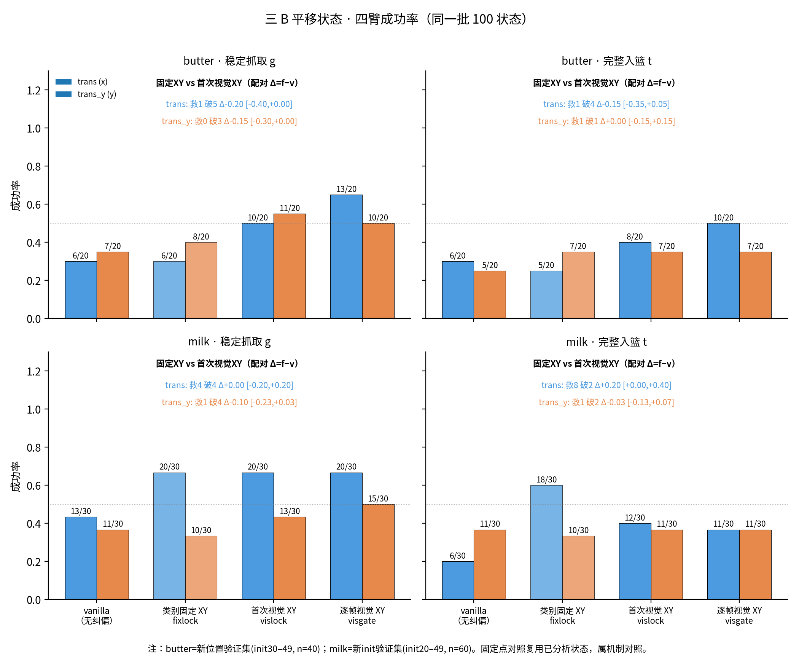
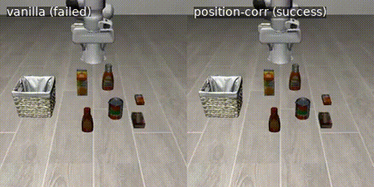

# vla-runtime-xy-correction

**冻结 VLA 策略的运行时横向纠偏：目标参考点到底需要什么？**

目标物体被移动后，冻结的视觉语言动作策略（OpenVLA，LIBERO `libero_object`）
仍按记忆中的位置下落并空抓。本项目在策略输出外加一个仅改写 **XY 通道** 的
因果触发控制器，并通过配对消融研究：纠偏所需的目标参考点究竟是什么。

论文草稿（中文初稿）：[`docs/PAPER_DRAFT_v2_1.md`](docs/PAPER_DRAFT_v2_1.md)

## 问题现象



*目标 +5cm 平移后，vanilla 沿原接近路径下落，闭合点落在物体旁侧。*

## 系统流程

```
LIBERO 环境 (robosuite, control_freq=20Hz, 回合上限 280 步)
  ├─ obs["agentview_image"] ──► get_libero_image：180°旋转 + lanczos resize
  │                              └─► OpenVLA 7B（4-bit，冻结）──► 原始 7-DoF 动作
  ├─ TargetEstimator（模板 NCC + 工作区过滤 + pix2w 仿射）
  │                              └─► 逐帧估计（visgate）或首次有效锁定（vislock）
  └─ CorrState 控制器（仅触发窗内、仅 XY 通道）
       触发：上一步夹爪开 ∧ z_gap∈[0,55]mm ∧（近4步净下降≥2mm ∨ z_gap<20mm）∧ |err_xy|>25mm
       动作：action[:2] = clip(15 · err_xy[米], ±0.8)   # 归一化动作量限幅
       释放：lat≤15mm | z_gap∉[-5,75]mm | 夹爪闭合（滞回）
       屏蔽：首次闭合命令起 raw 动作直通，重开解除
```

## 对照臂

同一批 **100 个留出平移状态**（butter n=40、milk n=60；扰动为回合初始 +5cm x 或 +5cm y）：

| 臂 | 目标 XY 来源 | 更新 |
|---|---|---|
| vanilla | —（无控制器） | — |
| gate | 仿真真值（特权参照） | 每步 |
| visgate | 逐帧视觉估计 | 每步 |
| vislock | 首个非空估计锁定整回合 | 一次 |
| fixlock | 与 vislock 相同逻辑，锁定 XY 替换为类固定点 | 一次 |

## 主结果



| 臂 | 稳定抓取 | 完整入篮 |
|---|---|---|
| vanilla | 37 | 28 |
| fixlock | 44 | 40 |
| vislock | 54 | 38 |
| visgate | 58 | 39 |

- **逐回合参考点有价值**：vislock − fixlock = **+10pp** 抓取，簇 bootstrap 95% CI [1,20]
- **逐帧更新边际有限**：两物体各净增 2 次抓取，分物体区间均跨零——如实报告证据边界
- **抓取≠任务**：milk trans 子集出现任务侧反向效应（fixlock 18 vs vislock 12），仅按配对账表报告
- **动作选择（补充实验，探索性/负结果）**：冻结选择器在 32 个确认状态上未超过保持基线动作（sel 24 vs c0 25/32）

状态口径：butter 为**新物体位置**验证，milk 为**留出 init**；
固定点与更新方式对照复用已分析状态（机制对照，非独立验证集）。

## 演示片段



*同状态下 vanilla（抓空）与纠偏臂的并排回放；更多片段见 `media/`。*

## 复现

### 免 GPU 核对数字（仅本仓库数据）

```bash
python scripts/verify_results.py
# 预期输出: g 37/44/54/58, t 28/40/38/39; visgate−vislock 每物体 +2; 4C 25/23/24
```

### 完整回放（需 GPU + LIBERO + OpenVLA）

```bash
# 1. 按 requirements.txt 安装上游依赖；克隆 OpenVLA 到同级目录或设置：
export OPENVLA_DIR=/path/to/openvla
#    检查点 openvla/openvla-7b-finetuned-libero-object 由 HF 自动下载

# 2. 跑一个代表回合组（示例：butter vislock 臂）
MUJOCO_GL=egl python scripts/run_correction_eval.py \
    --task_id 6 --init_list 30-49 --conditions trans,trans_y \
    --pos_override runs/predictability/butter_newpos.json \
    --arm vislock --out_prefix fzb
#    milk: --task_id 7 --init_list 20-49；臂: vanilla|gate|visgate|vislock|fixlock

# 3. 分析与出图
python scripts/verify_results.py        # 主表复算
python scripts/analyze_fixlock.py       # 配对/簇CI（部分字段需 npz 轨迹）
python scripts/plot_fixlock_main.py     # 主图 → results/fixlock_main.{png,pdf}
```

冻结协议（取值先于结局冻结，含代码哈希）：`runs/predictability/*_spec_2026-11-{16,17}.json`

## 目录结构

- `scripts/` — 运行器（`run_perturb_eval.py`、`run_correction_eval.py`）、估计器
  （`vision_target.py`）、冻结跑批、配对 CI 分析
- `runs/predictability/` — 冻结协议与类资产（`tmpl_*.png`、`pix2w_*.json`、状态清单）
- `results/` — 逐状态配对 CSV、汇总 JSON、病例复核 `corrige_3c.json`、主图
- `docs/` — 过程报告与论文草稿（中文初稿）
- `media/` — 对比回放片段（mp4/gif）

## 未随仓库分发（本地保留）

- OpenVLA 权重与 conda 环境（HF 自动下载）
- 逐回合 `.npz` 轨迹（~80MB）与全量视频（~115MB）
- 开发期日志与作废中间结果

需要 npz 字段的分析脚本会提示 missing states；主表数字不依赖它们。

## 局限

单策略单检查点、仅仿真、两个物体；扰动仅平移；估计器为模板匹配基线
（仿射与 z_prior 用离线真值标定）；选择器结论限于 c0/px 二选一与本扰动族。

## 第三方与许可

基于 OpenVLA（Stanford）、LIBERO、robosuite/MuJoCo，出处见 [`NOTICE.md`](NOTICE.md)。
本项目自有代码当前未声明开源许可证（TBD）。

## 论文状态

中文初稿（写作中，未发表）：[`docs/PAPER_DRAFT_v2_1.md`](docs/PAPER_DRAFT_v2_1.md)
